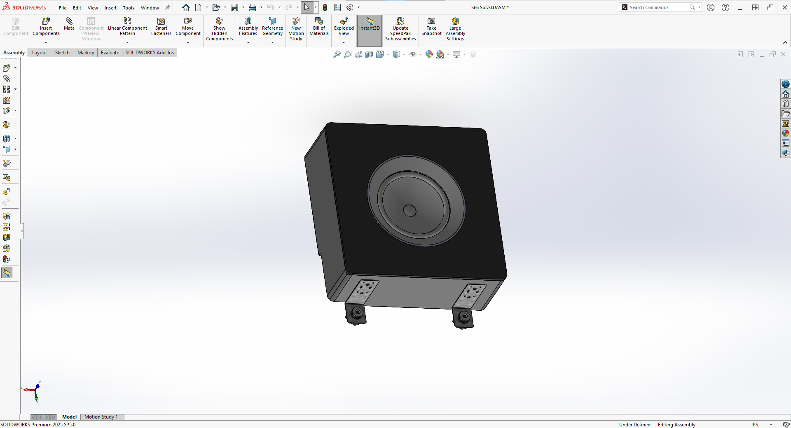
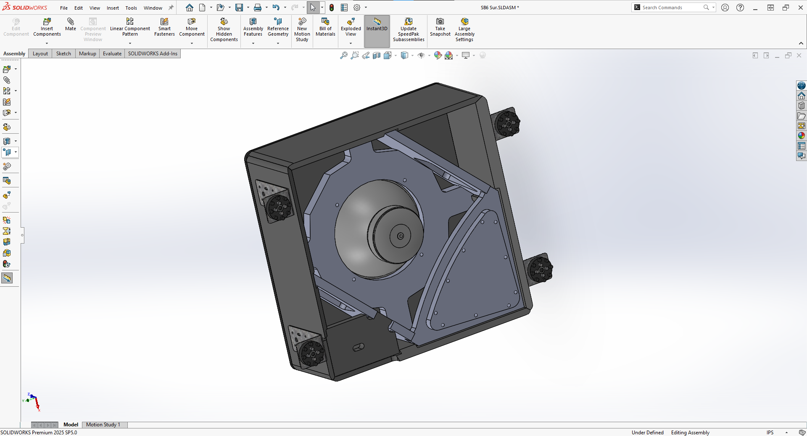
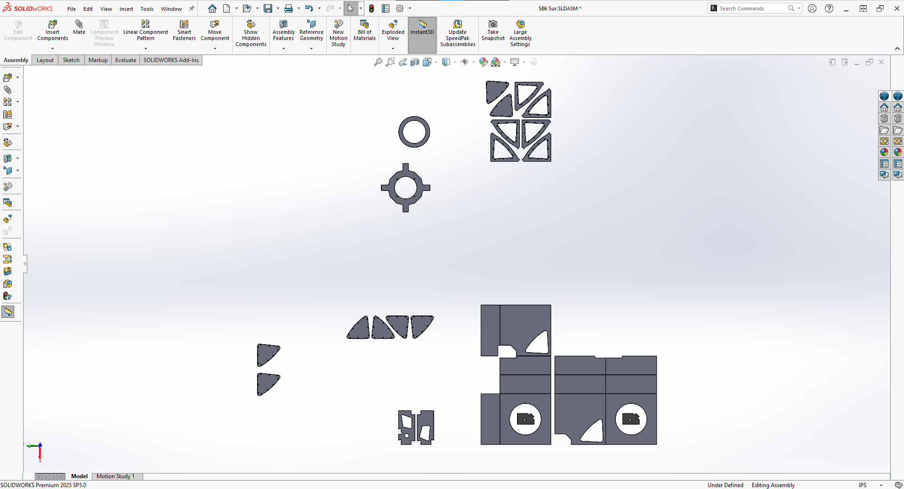

# Custom High-end Speakers

## Overview
This project involved designing and building custom high-end speakers for a customer's personal speaker system. My dad runs a small business named Portland Audio Lab, and over the course of a month, I helped my dad assemble 21 speakers, consisting of 6 subs (4 front and 2 back subs), 12 surround speakers, and 3 front speakers. I mostly worked on the surround speakers, but helped a bit on the others as well. There's a more detailed account of what we did [here](full_procedure.md). I'm just going to summarize it.

| [Building Front Speaker](Photos/Main%20Photos/front_speaker_assembly.jpeg) | [Front Speaker](Photos/Main%20Photos/front_speaker2.jpg) |
|:---:|:---:|
|  |  |

## Design and Machining
My dad did most of the designing using SolidWorks, but he talked me through some of the choices he made, particularly as it relates to the way that you have to design parts so that they're easier to assemble, and all fit together properly. He also taught me how to convert a SolidWorks model into a toolpath program, then into G-code that a CNC machine is able to use. We cut the parts on a CNC, then removed the excess material and cleaned up the parts.

[Link to the SolidWorks Files](Solidworks%20Files)

| [Surround Speaker](Photos/Solidworks/full_surround.png) | [Surround Speaker](Photos/Solidworks/surround_inside.png) | [Surround Parts](Photos/Solidworks/surround_parts.png) |
|:---:|:---:|:---:|
|  |  |  |

## Assembling the Boxes
To make the speaker boxes, we used tape to align the parts, then glued them together. The faces of the box came together nicely so we just used more tape instead of clamps to hold everything together while the glue dried. We got rid of any excess glue and made sure that everything was aligned properly.

| [Surround Speakers Drying](Photos/Main%20Photos/surrounds_unpainted.jpg) | [Surround Before Sanding and Painting](Photos/Main%20Photos/glued_surround.jpg) |
|:---:|:---:|
|  |  |

## Sanding and Painting
We used an orbital sander as a first pass to smooth things out. Afterwards, we sanded the boxes by hand with a finer grained sandpaper to clean things up and get a better polish. We applied three coats of paint, allowing each coat to dry and sanding between coats if needed. We followed this same process for the rings that would later fit around the drivers. After everything was sanded and painted, we added brackets to each box for wall mounting. Then we added a rubber material around the inner edges of the rings and the spots on the boxes where the rings sit to help hold them in place.

| [Painting Setup](Photos/Main%20Photos/painting_setup.jpg) | [Finished Surround Speaker](Photos/Main%20Photos/surround_speaker.jpeg) |
|:---:|:---:|
|  |  |

## Wiring and Testing
We trimmed and ran a pair of wires through each speaker box to later be connected to the home audio setup. These wires connect to crossovers we made, which control which frequencies are sent to the driver. We soldered the wires together at each connection, and connected everything to the drivers inside the boxes. The circuit diagram below shows all of the components and connections. Once assembled, we tested the speakers for air leaks and other issues. After confirming that they worked as expected, we cleaned them up, added felt covers to the fronts, and packaged them to be taken to their destination.

| [Surround Speaker Crossover](Photos/Main%20Photos/Surrounds%20Crossover.jpg) | [Circuit Diagram](Photos/Main%20Photos/circuit_diagram.jpg) |
|:---:|:---:|
|  |  |